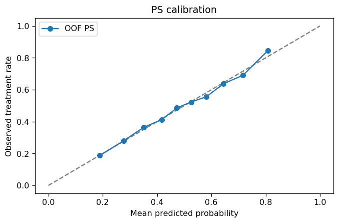
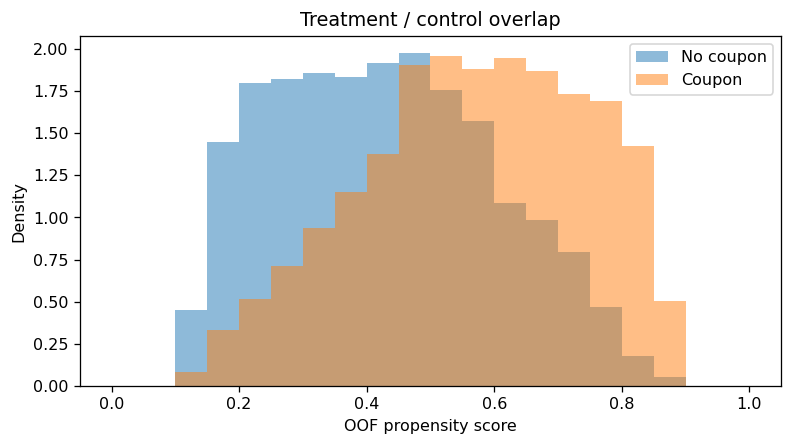
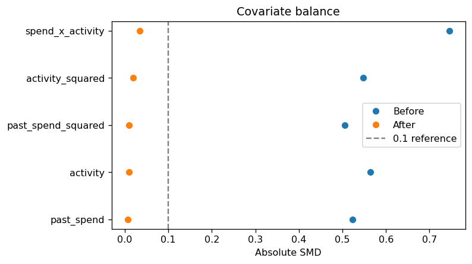
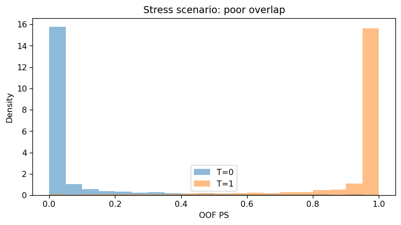

> **Project type: Simulation-based learning project. This project uses simulated data for 10,000 users to estimate the average effect of issuing coupons on subsequent customer spending. All results are based on simulated data and do not represent actual business outcomes at any company.

[下载完整 Python Notebook](Coupon_DRE_Complete_Project.ipynb) · [依赖列表](requirements.txt)

## 1. 问题：收到优惠券的人消费更高，能说明券有效吗？

假设平台更倾向于给历史消费高、活跃度高的用户发券。观察到收到券的用户消费更多，并不能直接把差异归因于优惠券：这些用户本来就可能消费更多。

这个项目要估计的问题是：**如果给目标人群中的所有用户发券，与都不发券相比，后续人均消费会改变多少？**

目标量是平均处理效应（Average Treatment Effect，ATE）。这里比较的是“是否发券”，而不是“是否核销券”；结果指标是后续消费金额，未指定现实中的币种和观察天数。

| 项目要素 | 定义 |
|---|---|
| 分析单位 | 一位用户，一行数据 |
| Treatment | `treatment = 1` 表示发券，`0` 表示不发券 |
| Outcome | `outcome`：发券之后的消费金额 |
| Pre-treatment features | `past_spend`：历史消费；`activity`：历史活跃度 |
| 目标 | 估计总体 ATE，并检查估计是否有数据支持 |

完整流程：明确假设 → 生成数据 → 五折 cross-fitting → PS 诊断 → overlap、权重与 balance → outcome 诊断 → AIPW → 模型设错与低 overlap 实验。

## 2. 为什么使用模拟数据？

现实中，同一个人只会实际处于一种状态，我们看不到他在另一种状态下的真实消费。模拟数据的价值在于：生成机制和真实效应已知，可以检查方法是否恢复了目标效应。

本项目用随机种子 `42` 生成 10,000 位用户。简化后的机制如下，完整代码见 Notebook：

```python
log_odds = -2 + 0.01 * past_spend + 0.2 * activity
true_ps = 1 / (1 + np.exp(-log_odds))
treatment = rng.binomial(1, true_ps)

baseline = 20 + 0.5 * past_spend + 5 * activity
true_effect = 10 + 2 * activity
outcome = baseline + treatment * true_effect + noise
```

历史消费和活跃度同时影响发券与消费，因此它们是需要调整的混杂变量。活跃度还影响优惠券的效果。

这次抽样有 4,984 位发券用户、5,016 位未发券用户。模拟总体的真实 ATE 为 **20.00 个消费金额单位**；这 10,000 位用户的真实效应均值约为 **20.065**。两者分别对应总体与具体样本，不应混为一个真值。

## 3. 在建模之前声明因果假设

- **无未观测混杂**：给定历史消费与活跃度后，处理分配与潜在结果条件独立。模拟机制保证了这一点；真实项目必须依赖业务知识，不能用预测分数证明。
- **Positivity / overlap**：目标人群的每类背景下，都有机会收到券或不收到券。
- **一致性与无干扰**：发券的含义明确，一位用户是否收到券不改变另一位用户的结果。
- **正确的时间顺序与抽样结构**：特征来自发券之前；本例将用户视为独立抽样单位。

这里使用 propensity score（PS）、IPW 与 AIPW，**没有执行 propensity score matching（PSM）**。PS 模型和 PSM 不是同一件事。

## 4. 三个模型，分别回答什么问题？

| 模型 | 训练数据 | 对每位用户预测什么 |
|---|---|---|
| Propensity model | 训练折中的全部用户 | 给定背景后收到券的概率 `ps` |
| Outcome model 0 | 训练折中未收到券的用户 | 不发券时的条件期望消费 `mu0` |
| Outcome model 1 | 训练折中收到券的用户 | 发券时的条件期望消费 `mu1` |

PS 使用 `LogisticRegression`，两个 outcome 模型使用 `LinearRegression`。本例的生成机制较简单，重点是理解估计与诊断，而不是复杂调参。

### 用 cross-fitting 产生样本外预测

把用户分成五折。每轮用四折训练模型，再对剩下的一折预测 `ps`、`mu0`、`mu1`；循环五次，保证每个用户的预测都来自没有使用其自身标签训练的模型。

对于 outcome model，不是把两个预测值“再训练一次”。两个已经训练好的模型分别对验证用户进行预测，产生两种处理状态下的条件期望。

Cross-fitting 减少同一批样本同时参与模型拟合与效应估计带来的问题，但不会补齐缺失对照或消除未观测混杂。[1]

## 5. PS 模型：不能只看 AUC

所有指标都使用 out-of-fold 预测，并与训练折处理率构成的常数基线比较。

| 指标 | PS 模型 | 常数基线 |
|---|---:|---:|
| ROC-AUC | 0.7136 | 0.4998 |
| Brier score | 0.2153 | 0.2500 |
| Log loss | 0.6192 | 0.6931 |

AUC 表示对处理状态的区分能力，不能作为因果模型的合格证。若处理状态几乎完全可预测，反而需要警惕可比用户不足。

Brier score 和 log loss 都优于基线，但它们不是纯粹的校准指标。还需要看校准图：预测大约 80% 概率收到券的人群，实际收到券的比例是否接近 80%，以及每个区间有多少用户。



## 6. Overlap、权重与 balance：有对照吗？加权稳定吗？

### Overlap

先对比两组的 PS 分布，再查看“历史消费 × 活跃度”网格中的处理组与对照组人数。本例两组有较广的重叠，没有用户的估计 PS 落在 `[0.05, 0.95]` 之外。

但这不证明每个高维区域都有充分对照。`0.05 / 0.95` 只是提醒检查尾部的示例阈值，不是通用标准。



### 权重与有效样本量

发券用户权重为 `1 / ps`，未发券用户权重为 `1 / (1 - ps)`。本项目没有自动截断权重。

| 分组 | 原始人数 | 有效样本量 ESS | ESS / 原始人数 | 最大权重 |
|---|---:|---:|---:|---:|
| 未发券 | 5,016 | 4,232.44 | 84.4% | 8.317 |
| 发券 | 4,984 | 4,102.63 | 82.3% | 8.285 |

ESS 描述权重集中程度，不等同于精确的实验功效。这里同时检查最大权重、99 分位权重和最重 1% 样本占据的权重份额。

### 加权后的协变量平衡

对每个已观测混杂变量检查标准化均值差（SMD），再增加平方项与交互项。

| 特征 | 加权前 SMD | 加权后 SMD |
|---|---:|---:|
| 历史消费 | 0.524 | 0.007 |
| 活跃度 | 0.565 | 0.010 |
| 历史消费平方 | 0.506 | 0.010 |
| 活跃度平方 | 0.548 | 0.020 |
| 历史消费 × 活跃度 | 0.746 | 0.035 |

图中 `0.1` 是常见经验参考。检查项的最大绝对加权 SMD 约为 0.0346，说明这些特征上的均值差显著减小；它仍不能证明未观测特征平衡或联合分布完全相同。



## 7. Outcome 模型：能验证什么，不能验证什么？

`model0` 只在实际未收到券的验证用户上，使用 `mu0` 与实际消费比较；`model1` 只在实际收到券的验证用户上，使用 `mu1` 与实际消费比较。

| 模型 | 样本外 MAE | 样本外 RMSE | 训练折分组均值基线 MAE |
|---|---:|---:|---:|
| 不发券模型 | 7.910 | 9.971 | 26.418 |
| 发券模型 | 8.187 | 10.230 | 28.712 |

两个模型均优于简单基线。Notebook 还按历史消费和活跃度分箱检查残差，防止总体平均误差掩盖局部偏差。

**不能用一个发券用户的实际消费去验证 `mu0`**：实际消费来自发券状态，而 `mu0` 是不发券状态的预测。事实状态预测良好，也不能直接证明反事实预测准确。

Overlap 同样影响 outcome model：没有可比的另一组样本时，反事实预测可能主要依赖模型外推。

## 8. AIPW：预测差异，加上残差修正

AIPW（Augmented Inverse Probability Weighting）是本项目使用的双重稳健估计量。核心计算是：

```python
dr_score = (
    mu1 - mu0
    + treatment * (outcome - mu1) / ps
    - (1 - treatment) * (outcome - mu0) / (1 - ps)
)
ate = dr_score.mean()
```

`mu1 - mu0` 是 outcome 模型预测的差异。后面两项利用真实发生状态下的预测残差和 PS 权重，修正总体估计。单个用户的 `dr_score` 是对总体估计的贡献，不能当作已经识别出的个人真实处理效应。

双重稳健指：在识别假设与其他必要条件成立时，PS 模型正确，或者两种状态的 outcome 条件均值模型正确，就能获得一致估计。它不保证有限样本里永远最准确，也不补救两侧共同遗漏混杂变量的问题。[2]

### 本次模拟结果

| 方法 | 估计的消费金额增量 |
|---|---:|
| 直接比较两组均值 | 45.190 |
| 归一化 IPW（Hájek） | 20.696 |
| 仅 outcome 模型 | 20.400 |
| DRE / AIPW | **20.394** |
| 模拟总体真实 ATE | **20.000** |

AIPW 的总体 ATE 近似 95% 置信区间为 **[19.949, 20.839]**，标准误约为 0.227。区间基于本例独立用户、cross-fitting、基线模型正确设定及常规条件下的影响函数计算。

“任一侧正确即可一致”不意味着“任一侧正确时，这个简单置信区间都自动有效”。真实项目仍需检查 nuisance 模型的收敛条件和抽样结构。

## 9. 故意把模型设错，会发生什么？

固定同一份数据和切分，只改变两个模型使用的特征：故意漏掉 `activity`。

| 场景 | AIPW 估计 |
|---|---:|
| 两侧都使用完整特征 | 20.394 |
| PS 完整，outcome 漏掉活跃度 | 20.520 |
| PS 漏掉活跃度，outcome 完整 | 20.417 |
| 两侧都漏掉活跃度 | **31.416** |

两侧都漏掉同一个混杂变量时，估计明显偏离已知真值。坏 PS 加权后的活跃度 SMD 仍约为 0.610，也提示加权未能解决该变量的不平衡。

这是一次真值已知的教学实验，不是双重稳健性的普遍证明。在真实业务里，不能用未知的真实 ATE 来选择模型，也不能仅凭诊断分数断言某一侧已经正确。

## 10. 如果数据本身没有足够 overlap 呢？

第二个模拟将发券机制改为：低历史消费用户几乎不发券，高历史消费用户几乎都发券。

此时：

- 约 **78.9%** 用户的估计 PS 位于 `[0.05, 0.95]` 之外。
- 发券组 ESS 只剩约 **41.6**，相当于原组人数的 **0.8%**。
- 最大权重升至约 **1,180.8**。
- 历史消费在 150–200 的区域中，有 2,442 位发券用户、**0 位未发券用户**。



这里更复杂的模型无法创造缺失的对照。可以考虑补充数据、开展随机实验，或明确把研究对象限制在有支持的人群；最后一种做法会改变目标人群与 estimand。

截断权重只是偏差和方差之间的取舍，不能修复结构性缺失对照。即使代码能计算出一个全体 ATE，也不等于这个数字可靠。

## 11. 我从这个项目里学到什么？

**模型能运行、预测指标不错、因果结论可信，是三个不同层次的问题。**

本例中，直接均值差约为 45.19，而调整后的 AIPW 约为 20.39，更接近已知总体效应 20。这个结论建立在已知模拟机制与诊断结果之上，不能推广为“真实业务中发券一定增加这么多消费”。

迁移到真实数据时，还需要明确时间零点与消费窗口，检查重复发券、缺失、处理后变量、未观测混杂和干扰，并按实际抽样结构做推断。消费增量也不等于利润增量，发券决策还需要毛利与券成本。

## 代码与复现

下载 [完整 Notebook](Coupon_DRE_Complete_Project.ipynb)，安装依赖后在 Jupyter 中选择 **Restart Kernel and Run All**。

```bash
pip install numpy pandas scikit-learn matplotlib jupyter
jupyter notebook Coupon_DRE_Complete_Project.ipynb
```

下载版保留全部代码和解释，清空了执行输出以方便从头运行。本文图表与数值取自原 Notebook 保存的运行结果；不同依赖版本可能带来轻微数值差异。

## 参考资料

1. [Zhong et al. (2021), AIPW: An R Package for Augmented Inverse Probability–Weighted Estimation of Average Causal Effects](https://pmc.ncbi.nlm.nih.gov/articles/PMC8796813/)。交叉拟合与 AIPW 的方法背景。
2. [Funk et al. (2011), Doubly Robust Estimation of Causal Effects](https://pmc.ncbi.nlm.nih.gov/articles/PMC3070495/)。双重稳健估计与识别假设。
