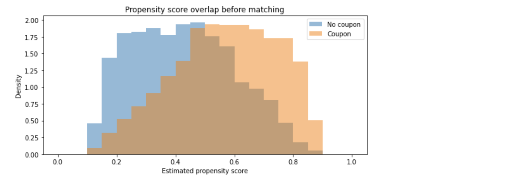
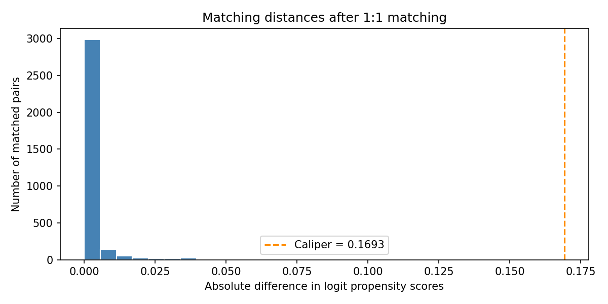

> **Project type: Simulation-based learning project.** In this case study, I walk through a simplified causal inference project to demonstrate how doubly robust estimation can estimate the average effect of issuing coupons on customer spending. All results are based on simulated data and do not represent actual business outcomes at any company. 

### Jump to a step

1. [Business Context](#1-Business-Context)
2. [Generate the simulated data](#2-generate-the-simulated-data)
3. [True ATE vs. True ATT vs. Naive Difference](#3-true-ate-vs-true-att-vs-naive-difference)
4. [Adjust for Selection Bias with Propensity Score Matching](#4-adjust-for-selection-bias-with-propensity-score-matching)


## 1. Business Context
Consider an e-commerce platform that has already distributed coupons to some customers. Customers with higher historical spending and engagement were more likely to receive them. We want to know what is the average increase in customer spending caused by receiving a coupon.

I will use a simulated simple dataset of 10,000 users containing 4 variables: 
(1) historical spending
(2) pre-treatment engagement
(3) coupon assignment 
(4) subsequent spending

## 2. Generate the simulated data

The DataFrame `df` is a simulated dataset of 10,000 customers. Each row represents one customer with four observed variables:

1. **Historical spending:** I randomly generate a value between 0 and 200 for each customer using a uniform distribution. This represents how much the customer spent before coupon assignment.

2. **Pre-treatment engagement:** I randomly generate an integer from 0 to 10, inclusive, for each customer. Higher values represent greater engagement before coupon assignment.

3. **Coupon assignment:** I first calculate each customer's probability of receiving a coupon based on historical spending and engagement. Customers with higher spending and engagement have higher probabilities. I then use these probabilities to randomly assign coupons: `1` means the customer receives a coupon, and `0` means they do not. In this simulated sample, **4,984 customers (49.84%) receive a coupon**, while **5,016 (50.16%) do not**.

4. **Subsequent spending:** I first calculate expected spending without a coupon as `20 + 0.5 * past_spend + 5 * activity`. For customers who receive a coupon, I add a coupon effect of `10 + 2 * activity`, so more engaged customers receive a larger spending lift. Finally, I add normally distributed random noise with a mean of 0 and a standard deviation of 10 to every customer's spending. The final formula is `outcome = baseline + coupon_assignment * true_effect + noise`.

### Code

```python
import numpy as np
import pandas as pd

# Create a random number generator and store it in the variable 'rng'.
rng = np.random.default_rng(42)

# Set n as the number of customers, and n=10,000
n = 10000

# (1) Historical Spending: a random number between 0 to 200
past_spend = rng.uniform(0, 200, n)

# (2) pre-treatment engagement: a random integer between 0 to 10
activity = rng.integers(0, 11, n)

# (3) Coupon Assignment: customers with high past_spend and high activity are more likely to receive a coupon
# Create a coupon issuance probability to generate simulated coupon assignments.
# treatment=1 means the customer received a coupon; treatment=0 means they did not.
log_odds = -2 + 0.01 * past_spend + 0.2 * activity
true_ps = 1 / (1 + np.exp(-log_odds))
treatment = rng.binomial(1, true_ps)

# (4) Subsequent Spending
# Spending when there is no coupon assigned
baseline = 20 + 0.5 * past_spend + 5 * activity
# The true coupon effect when a customer receives a coupon
true_effect = 10 + 2 * activity
# Add noise to spending
noise = rng.normal(0, 10, n)
# The final subsequent spending = baseline + treatment * true_effect + noise
outcome = baseline + treatment * true_effect + noise

# Aggregate all data into a dataframe
df = pd.DataFrame({
    'past_spend': past_spend,
    'activity': activity,
    'coupon_assignment': treatment,
    'subsequent_spending': outcome
})

display(df.head(10))
display(df.describe())
```

### Output


`display(df.head(10))`

| | past_spend | activity | coupon_assignment | subsequent_spending |
|---|---:|---:|---:|---:|
| 0 | 154.791210 | 0 | 0 | 87.184820 |
| 1 | 87.775688 | 7 | 1 | 116.847515 |
| 2 | 171.719584 | 2 | 1 | 135.199143 |
| 3 | 139.473606 | 7 | 0 | 124.498443 |
| 4 | 18.835470 | 6 | 0 | 54.645706 |
| 5 | 195.124470 | 2 | 1 | 132.531542 |
| 6 | 152.227940 | 5 | 1 | 130.981857 |
| 7 | 157.212861 | 0 | 1 | 107.288876 |
| 8 | 25.622727 | 7 | 0 | 88.069488 |
| 9 | 90.077188 | 3 | 0 | 85.696460 |

<!-- output-split -->

`display(df.describe())`

| | past_spend | activity | coupon_assignment | subsequent_spending |
|---|---:|---:|---:|---:|
| count | 10000.000000 | 10000.000000 | 10000.000000 | 10000.000000 |
| mean | 99.424320 | 5.032600 | 0.498400 | 105.848177 |
| std | 57.644184 | 3.155144 | 0.500022 | 40.495370 |
| min | 0.062884 | 0.000000 | 0.000000 | -1.792771 |
| 25% | 49.207598 | 2.000000 | 0.000000 | 75.279554 |
| 50% | 99.660298 | 5.000000 | 0.000000 | 105.355246 |
| 75% | 149.135540 | 8.000000 | 1.000000 | 134.962128 |
| max | 199.995404 | 10.000000 | 1.000000 | 218.490703 |



## 3. True ATE vs. True ATT vs. Naive Difference

Because this dataset is simulated, we know each customer’s true coupon effect. We can therefore calculate two benchmarks: the true ATE, which averages these effects across all 10,000 customers, and the true ATT, which averages them only among customers who actually received a coupon.

I compare both benchmarks with the naive difference: the difference in average observed spending between coupon recipients and non-recipients. This comparison illustrates why the target population matters and why a simple comparison between the two groups may not recover the causal effect.

### Code

```python
# True ATE: the average coupon effect across all 10,000 customers
# true_effect = 10 + 2 * activity
true_ate = true_effect.mean()

# True ATT: the average coupon effect among actual coupon recipients
received_coupon = df['coupon_assignment'].to_numpy() == 1
true_att = true_effect[received_coupon].mean()

# Naive difference: average observed spending with vs. without a coupon
group_mean = df.groupby('coupon_assignment')['subsequent_spending'].mean()
naive_difference = group_mean.loc[1] - group_mean.loc[0]

# Summarize the three comparisons in a DataFrame
comparison = pd.DataFrame({
    'Metric': ['True ATE', 'True ATT', 'Naive Difference'],
    'Value': [true_ate, true_att, naive_difference],
    'Interpretation': [
        'Average causal effect across all 10,000 customers: '
        'spending if everyone received a coupon versus if no one did.',

        'Average causal effect among actual coupon recipients: '
        'their spending with a coupon versus without one.',

        'Difference in average observed spending between '
        'coupon recipients and non-recipients.'
    ]
})

display(
    comparison.style
    .format({'Value': '{:.2f}'})
)

# Compare pre-treatment characteristics and subsequent spending by group
display(
    df.groupby('coupon_assignment')[['past_spend', 'activity', 'subsequent_spending']].mean()
)
```

### Output

| | Metric | Value | Interpretation |
|---|---|---:|---|
| 0 | True ATE | 20.07 | Average causal effect across all 10,000 customers: spending if everyone received a coupon versus if no one did. |
| 1 | True ATT | 21.79 | Average causal effect among actual coupon recipients: their spending with a coupon versus without one. |
| 2 | Naive Difference | 45.19 | Difference in average observed spending between coupon recipients and non-recipients. |

| coupon_assignment | past_spend | activity | subsequent_spending |
|---|---:|---:|---:|
| 0 | 84.869642 | 4.178030 | 83.325577 |
| 1 | 114.072446 | 5.892657 | 128.515383 |

**Interpretation:**

**1. True ATE vs. True ATT: effects for different target populations.**

ATE (Average Treatment Effect) averages the causal effect across all 10,000 customers. ATT (Average Treatment Effect on the Treated) averages it only among the 4,984 customers who actually received coupons. Each compares its target customers under two scenarios: receiving a coupon and not receiving one. In real-world data, we cannot observe both outcomes for the same customer under otherwise identical conditions. Here, we know both benchmarks because we specified the simulation’s effect mechanism.

The true sample ATE is **$20.07**, while the true sample ATT is **$21.79**. Coupon recipients have higher average engagement, and we defined the coupon effect as `10 + 2 * activity`. Their average coupon effect is therefore larger. This difference reflects the target populations and varying coupon effects; it is not an estimation error.

**2. Naive Difference vs. both causal benchmarks: selection bias.**

The naive difference simply subtracts the average observed spending of non-recipients from that of coupon recipients, without adjusting for differences between the groups.

The naive difference is **$45.19** ($128.52 − $83.33), substantially higher than both the true ATE of **$20.07** and the true ATT of **$21.79**.

Coupon recipients already had higher historical spending (**114.07 vs. 84.87**) and engagement (**5.89 vs. 4.18**). These characteristics also increase spending without a coupon. This creates selection bias: customers who would tend to spend more anyway are more likely to receive a coupon.

As a result, the naive difference mixes the coupon’s causal effect with pre-existing differences between the groups. It overstates both ATE and ATT in this simulation.

## 4. Adjust for Selection Bias with Propensity Score Matching

Suppose our goal is to estimate ATT: the average effect of coupons on customers who actually received them. Several methods can help estimate this effect, including outcome regression, propensity score weighting, and matching. Here, I will use propensity score matching (PSM) as an example.

The idea of PSM is to find comparable customers who did not receive coupons and use their spending to approximate what coupon recipients would have spent without one.

### How does PSM work?

1. **Estimate propensity scores.**

   A **propensity score** is the probability of receiving treatment given a set of observed pre-treatment characteristics. It can be estimated using a classification model, such as logistic regression, with treatment assignment as the target.

   In this case, treatment is receiving a coupon. The model estimates each customer’s probability of receiving one, where coupon assignment is 1 for recipients and 0 for non-recipients.

2. **Choose the model inputs.**

   **Confounders** are variables that influence both treatment assignment and the outcome. They can create pre-existing differences between treatment and control groups, making a simple outcome comparison misleading. Including these variables in the propensity score model helps matching adjust for those differences.

   In this case, historical spending and pre-treatment engagement are confounders. Customers with higher values are more likely to receive coupons and would also tend to spend more without a coupon.

3. **Match observations and assess comparability.**

   **Propensity score matching** pairs treated observations with untreated observations that have similar propensity scores. One approach is **1:1 matching**, which selects one control observation for each matched treated observation.

   Similar propensity scores do not guarantee identical characteristics within each pair. **Covariate balance** describes how similar the distributions of pre-treatment characteristics are between the matched groups and must be checked after matching.

   In this case, each matched coupon recipient is paired with a non-recipient. Matching quality is assessed by comparing historical spending and engagement between the matched groups.

4. **Estimate the treatment effect.**

   With adequate matching quality and under the required causal assumptions, the average outcome difference between matched treated and control observations can estimate the average treatment effect among the retained treated observations. If treated observations are excluded, the estimate does not automatically apply to the entire original treated population.

   In this case, the average subsequent spending difference between matched coupon recipients and non-recipients estimates the coupon’s effect among the retained recipients.

### 4.1 Estimate Propensity Scores

Because the coupon assignment mechanism in this simulation follows a logistic form, logistic regression is used to estimate propensity scores. In real-world applications, where the true assignment mechanism is unknown, logistic regression can serve as a starting point, with the model specification refined using subject-matter knowledge and matching diagnostics.

#### Code

```python
from sklearn.pipeline import make_pipeline
from sklearn.preprocessing import StandardScaler
from sklearn.linear_model import LogisticRegression

# 1. Estimate coupon probabilities using pre-treatment variables only
psm_data = df.copy()
features = ['past_spend', 'activity']
ps_model = make_pipeline(
    StandardScaler(),
    LogisticRegression(max_iter=1000, random_state=42)
)
ps_model.fit(psm_data[features], psm_data['coupon_assignment'])
psm_data['propensity_score'] = ps_model.predict_proba(psm_data[features])[:, 1]

display(psm_data)
```

#### Output

| | past_spend | activity | coupon_assignment | subsequent_spending | propensity_score |
|---|---:|---:|---:|---:|---:|
| 0 | 154.791210 | 0 | 0 | 87.184820 | 0.392204 |
| 1 | 87.775688 | 7 | 1 | 116.847515 | 0.564984 |
| 2 | 171.719584 | 2 | 1 | 135.199143 | 0.531588 |
| 3 | 139.473606 | 7 | 0 | 124.498443 | 0.686560 |
| 4 | 18.835470 | 6 | 0 | 54.645706 | 0.346991 |
| ... | ... | ... | ... | ... | ... |
| 9995 | 89.349407 | 1 | 0 | 71.228992 | 0.288442 |
| 9996 | 61.869468 | 10 | 1 | 139.804893 | 0.643284 |
| 9997 | 33.069394 | 3 | 0 | 52.639808 | 0.253784 |
| 9998 | 74.682080 | 8 | 1 | 143.106050 | 0.580725 |
| 9999 | 96.181555 | 9 | 1 | 141.222840 | 0.676958 |

10000 rows × 5 columns

### 4.2 Perform 1:1 Matching

**Matching options**

- 1:1 without replacement (This analysis will use 1:1 matching without replacement.)
- 1:1 with replacement
- 1:k matching

To find a suitable non-recipient for each recipient, this analysis uses **greedy nearest-neighbor matching**. “Greedy” means choosing the best available option at each step, then moving on without revisiting earlier decisions. Here, the best available option is the unused control with the smallest absolute difference in **logit propensity scores**.


A **caliper**, or maximum permitted matching distance, is set to **0.2 times the standard deviation of the estimated logit scores**, approximately **0.1693** in this run. If the nearest available control exceeds this distance, the recipient remains unmatched. This threshold is a starting point for the matching design; its suitability is assessed through the matching diagnostics that follow.

#### Code

```python
# Define the two groups before matching
recipients = psm_data.loc[
    psm_data['coupon_assignment'] == 1
].copy()

non_recipients = psm_data.loc[
    psm_data['coupon_assignment'] == 0
].copy()

# ============================================================
# Perform 1:1 nearest-neighbor matching without replacement
# ============================================================

# Match on the logit of the estimated propensity score
psm_data['ps_logit'] = ps_model.decision_function(
    psm_data[features]
)

# Illustrative caliper: 0.2 SD of logit propensity scores
caliper = 0.2 * psm_data['ps_logit'].std(ddof=1)

available_controls = non_recipients.index.tolist()
pair_rows = []

# A fixed random order makes the procedure reproducible
recipient_order = recipients.sample(
    frac=1,
    random_state=42
).index

for recipient_id in recipient_order:

    if not available_controls:
        break

    distances = (
        psm_data.loc[available_controls, 'ps_logit']
        - psm_data.loc[recipient_id, 'ps_logit']
    ).abs()

    control_id = distances.idxmin()
    distance = distances.loc[control_id]

    if distance <= caliper:
        pair_rows.append({
            'recipient_id': recipient_id,
            'control_id': control_id,
            'logit_distance': distance
        })

        # Each control can be used only once
        available_controls.remove(control_id)

pairs = pd.DataFrame(
    pair_rows,
    columns=['recipient_id', 'control_id', 'logit_distance']
)

if pairs.empty:
    raise ValueError(
        'No matches found. Review overlap and matching settings.'
    )

matched_recipients = psm_data.loc[
    pairs['recipient_id']
].copy()

matched_controls = psm_data.loc[
    pairs['control_id']
].copy()

assert pairs['recipient_id'].is_unique
assert pairs['control_id'].is_unique

display(matched_recipients)
display(matched_controls)

display(pairs)
```

#### Output

**display(matched_recipients)**

| | past_spend | activity | coupon_assignment | subsequent_spending | propensity_score | ps_logit |
|---|---:|---:|---:|---:|---:|---:|
| 3050 | 177.311583 | 0 | 1 | 124.221529 | 0.447600 | -0.210374 |
| 5604 | 109.611922 | 5 | 1 | 95.734842 | 0.522173 | 0.088751 |
| 954 | 188.003802 | 4 | 1 | 171.083255 | 0.664761 | 0.684584 |
| 5049 | 196.048925 | 7 | 1 | 178.817421 | 0.795120 | 1.356066 |
| 1391 | 167.495149 | 1 | 1 | 129.746658 | 0.471804 | -0.112904 |
| ... | ... | ... | ... | ... | ... | ... |
| 6886 | 85.118571 | 0 | 1 | 84.931895 | 0.241870 | -1.142453 |
| 2428 | 126.325708 | 3 | 1 | 123.474688 | 0.466127 | -0.135701 |
| 4941 | 10.670196 | 8 | 1 | 73.268186 | 0.420331 | -0.321414 |
| 280 | 8.695012 | 9 | 1 | 100.429823 | 0.463896 | -0.144668 |
| 6458 | 102.087514 | 1 | 1 | 92.381288 | 0.315575 | -0.774181 |

3500 rows × 6 columns

**display(matched_controls)**

| | past_spend | activity | coupon_assignment | subsequent_spending | propensity_score | ps_logit |
|---|---:|---:|---:|---:|---:|---:|
| 1910 | 2.203333 | 9 | 0 | 70.732074 | 0.447618 | -0.210299 |
| 8008 | 168.016875 | 2 | 0 | 108.000730 | 0.522257 | 0.089085 |
| 3087 | 90.722836 | 9 | 0 | 104.569499 | 0.664774 | 0.684640 |
| 4953 | 196.128055 | 7 | 0 | 159.005527 | 0.795250 | 1.356866 |
| 7512 | 11.872576 | 9 | 0 | 82.879858 | 0.471894 | -0.112543 |
| ... | ... | ... | ... | ... | ... | ... |
| 6174 | 85.108794 | 0 | 0 | 61.309641 | 0.241852 | -1.142552 |
| 1431 | 122.444202 | 3 | 0 | 102.651078 | 0.456375 | -0.174943 |
| 6713 | 126.066677 | 2 | 0 | 91.954947 | 0.417016 | -0.335035 |
| 3329 | 44.607226 | 7 | 0 | 74.020488 | 0.456356 | -0.175022 |
| 5625 | 121.539102 | 0 | 0 | 64.668662 | 0.315563 | -0.774238 |

3500 rows × 6 columns

**display(pairs)**

| | recipient_id | control_id | logit_distance |
|---|---:|---:|---:|
| 0 | 3050 | 1910 | 0.000075 |
| 1 | 5604 | 8008 | 0.000334 |
| 2 | 954 | 3087 | 0.000056 |
| 3 | 5049 | 4953 | 0.000800 |
| 4 | 1391 | 7512 | 0.000362 |
| ... | ... | ... | ... |
| 3495 | 6886 | 6174 | 0.000099 |
| 3496 | 2428 | 1431 | 0.039242 |
| 3497 | 4941 | 6713 | 0.013621 |
| 3498 | 280 | 3329 | 0.030354 |
| 3499 | 6458 | 5625 | 0.000058 |

3500 rows × 3 columns

**Interpretation:** The procedure retains **3,500 pairs**, including approximately **70.2% of the original coupon recipients**. It excludes **1,484 recipients**. An unmatched recipient does not necessarily have no similar non-recipient in the original data; a suitable control may already have been used.

Because some recipients are excluded, the estimate now targets the recipients retained in the matched sample.

### 4.3 Assess Matching Quality

The quality of the PSM analysis is assessed using four checks.

| Check | When to check | Purpose | What to examine |
|---|---|---|---|
| **1. Overlap** | Before matching | Determine whether comparable controls are available for treated observations. | Propensity score distributions and treatment/control counts across score ranges. |
| **2. Matching distance** | After matching | Assess how close the selected matches are. | The distribution of within-pair distances and compliance with the caliper. |
| **3. Covariate balance** | After matching | Assess whether matching reduces pre-treatment differences between groups. | Before-and-after SMDs, variance ratios, and covariate distributions. |
| **4. Sample retention and target population** | After matching | Understand who remains in the analysis and whom the estimate represents. | Matched/unmatched counts, retention rates, and characteristics of retained versus excluded treated observations. |

#### Check 1: Overlap

#### Code

```python
import matplotlib.pyplot as plt

features = ['past_spend', 'activity']

assert psm_data.index.is_unique, "Each customer must have a unique index."

recipients = psm_data.loc[
    psm_data['coupon_assignment'] == 1
].copy()

non_recipients = psm_data.loc[
    psm_data['coupon_assignment'] == 0
].copy()


# ============================================================
# Check 1: Overlap — before matching
# ============================================================

# Compare propensity score distributions
plt.figure(figsize=(8, 4))

bins = np.linspace(0, 1, 21)

plt.hist(
    non_recipients['propensity_score'],
    bins=bins,
    density=True,
    alpha=0.5,
    label='No coupon'
)

plt.hist(
    recipients['propensity_score'],
    bins=bins,
    density=True,
    alpha=0.5,
    label='Coupon'
)

plt.xlabel('Estimated propensity score')
plt.ylabel('Density')
plt.title('Propensity score overlap before matching')
plt.legend()
plt.tight_layout()
plt.show()
```

#### Output



#### Code

```python
# Count customers in each propensity score range
score_bins = pd.cut(
    psm_data['propensity_score'],
    bins=np.linspace(0, 1, 6),
    include_lowest=True
)

overlap_counts = pd.crosstab(
    score_bins,
    psm_data['coupon_assignment'],
    dropna=False
).reindex(columns=[0, 1], fill_value=0)

overlap_counts.columns = ['No coupon', 'Coupon']

print('Check 1: Customer counts by propensity score range')
display(overlap_counts)
```

#### Output

Check 1: Customer counts by propensity score range

| propensity_score | No coupon | Coupon |
|---|---:|---:|
| (-0.001, 0.2] | 475 | 102 |
| (0.2, 0.4] | 1828 | 827 |
| (0.4, 0.6] | 1822 | 1778 |
| (0.6, 0.8] | 833 | 1807 |
| (0.8, 1.0] | 58 | 470 |

**Interpretation：** Both groups appear in every checked range, but the highest-score range has only **58 non-recipients versus 470 recipients**. Even with overall overlap, some recipients may not have a sufficiently close, unused control under 1:1 matching without replacement.

#### Check 2: Matching Distance

Matching distance measures how close the selected recipient–control pairs are on the logit propensity score scale. The summary below describes the typical distance, the upper end of the distribution, and whether any pairs exceed the caliper.

#### Code

```python
# ============================================================
# Check 2: Matching distance — after matching
# ============================================================
import matplotlib.pyplot as plt

pair_distances = pairs['logit_distance']
outside_caliper = pair_distances.gt(caliper).sum()

distance_summary = pd.DataFrame({
    'Statistic': [
        'Matched pairs',
        'Median logit distance',
        '90th percentile logit distance',
        'Maximum logit distance',
        'Caliper',
        'Pairs exceeding the caliper'
    ],
    'Value': [
        str(len(pairs)),
        f"{pair_distances.median():.6f}",
        f"{pair_distances.quantile(0.90):.6f}",
        f"{pair_distances.max():.6f}",
        f"{caliper:.6f}",
        str(outside_caliper)
    ]
})

display(distance_summary)

plt.figure(figsize=(8, 4))
plt.hist(
    pair_distances,
    bins=np.linspace(0, max(caliper, pair_distances.max()), 31),
    color='steelblue',
    edgecolor='white'
)
plt.axvline(
    caliper,
    color='darkorange',
    linestyle='--',
    label=f'Caliper = {caliper:.4f}'
)
plt.xlabel('Absolute difference in logit propensity scores')
plt.ylabel('Number of matched pairs')
plt.title('Matching distances after 1:1 matching')
plt.legend()
plt.tight_layout()
plt.show()
```

#### Output

| | Statistic | Value |
|---|---|---:|
| 0 | Matched pairs | 3500 |
| 1 | Median logit distance | 0.000485 |
| 2 | 90th percentile logit distance | 0.013117 |
| 3 | Maximum logit distance | 0.168853 |
| 4 | Caliper | 0.169311 |
| 5 | Pairs exceeding the caliper | 0 |



**Interpretation:** The median matching distance is approximately **0.000485**, and **90% of pairs have distances no greater than 0.013117**. Most pairs are therefore close on the selected matching scale. The maximum distance is **0.168853**, just below the caliper of **0.169311**.

**No pairs exceed the caliper**, as required by the matching algorithm. This confirms that the selected pairs satisfy the distance rule; Check 3 assesses whether the matched groups are also balanced on historical spending and engagement.

#### Check 3: Covariate Balance

Similar propensity scores do not guarantee that the matched groups have similar pre-treatment characteristics. Covariate balance is checked to assess whether matching has reduced these differences.

The standardized mean difference (**SMD**) measures the difference between the two groups’ means relative to their variability. An absolute SMD (**|SMD|**) below **0.1** is commonly used as a rule of thumb for acceptable mean balance; values closer to zero indicate better mean balance.

```python
balance_rows = []
for feature in features:
    # Keep the original pooled SD fixed for before/after comparisons
    pooled_sd = np.sqrt(
        (recipients[feature].var(ddof=1)
         + non_recipients[feature].var(ddof=1)) / 2
    )
    balance_rows.append({
        'Feature': feature,
        'Recipient mean (matched)': matched_recipients[feature].mean(),
        'Control mean (matched)': matched_controls[feature].mean(),
        'SMD before': (
            recipients[feature].mean() - non_recipients[feature].mean()
        ) / pooled_sd,
        'SMD after': (
            matched_recipients[feature].mean()
            - matched_controls[feature].mean()
        ) / pooled_sd
    })
balance = pd.DataFrame(balance_rows)
display(balance.round(3))
```

#### Output

| | Feature | Recipient mean (matched) | Control mean (matched) | SMD before | SMD after |
|---|---|---:|---:|---:|---:|
| 0 | past_spend | 99.626 | 98.840 | 0.524 | 0.014 |
| 1 | activity | 5.025 | 5.029 | 0.565 | -0.001 |

**Interpretation.** The absolute SMDs fall from approximately **0.524 to 0.014** for historical spending and **0.565 to 0.001** for engagement. These observed means are much closer after matching.

This table checks mean balance only. A more complete assessment would also inspect distributions, variances, and relevant nonlinear terms or interactions. A small SMD is not proof that all confounding has been removed. If covariate balance remains poor, the matching design should be revised before interpreting the outcome comparison.

### 4.4 Estimate the effect and compare the appropriate benchmark

For each matched pair, I subtract the non-recipient's spending from the recipient's spending, then average the differences. I convert the outcome columns to arrays so pandas does not align the different customer IDs.

Because this is simulated data, I can also calculate the true average coupon effect for the **same retained recipients**. True effects are used only for evaluation, never for deciding the matching rules or choosing pairs.

```python
# 4. Estimate the average effect among retained recipients
# Use arrays so pandas does not align different customer IDs
psm_effect = (
    matched_recipients['subsequent_spending'].to_numpy()
    - matched_controls['subsequent_spending'].to_numpy()
).mean()

# Simulation benchmark only: never use true effects to choose matches
true_effect_by_customer = pd.Series(true_effect, index=df.index)
matched_true_effect = true_effect_by_customer.loc[pairs.recipient_id].mean()

psm_comparison = pd.DataFrame({
    'Metric': [
        'Naive Difference',
        'True ATT: all coupon recipients',
        'True effect: matched coupon recipients',
        'PSM estimate: matched coupon recipients'
    ],
    'Value': [
        naive_difference,
        true_effect_by_customer.loc[recipients.index].mean(),
        matched_true_effect,
        psm_effect
    ]
})
display(psm_comparison.round(2))
```

#### Output

| | Metric | Value |
|---|---|---:|
| 0 | Naive Difference | 45.19 |
| 1 | True ATT: all coupon recipients | 21.79 |
| 2 | True effect: matched coupon recipients | 20.05 |
| 3 | PSM estimate: matched coupon recipients | 20.84 |

**Interpretation.** PSM estimates an average spending increase of approximately **$20.84 among matched coupon recipients**. The corresponding true average effect is **$20.05**. Matching substantially reduces the discrepancy seen in the original naive difference of **$45.19**, but the point estimate still differs from its simulation benchmark by approximately **$0.79**.

The true ATT for all original coupon recipients is **$21.79**. Its difference from the matched recipients' true effect reflects a change in the target population. Therefore, the PSM estimate should be compared with **$20.05**, not treated as an estimate of the full-population ATE or automatically as an estimate of ATT for every original recipient.

This section reports a point estimate and descriptive diagnostics, not a confidence interval. A causal interpretation requires sufficient overlap for the retained population, consistency and no interference, and no unmeasured confounding given the selected pre-treatment variables. These conditions follow from the way this simulation was constructed; in a real study, they would require substantive justification.

### References for matching and diagnostics

- [MatchIt: Assessing Balance](https://kosukeimai.github.io/MatchIt/articles/assessing-balance.html)
- [MatchIt: Matching Methods](https://kosukeimai.github.io/MatchIt/articles/matching-methods.html)
- [MatchIt: Matching for Causal Inference](https://kosukeimai.github.io/MatchIt/reference/matchit.html)
